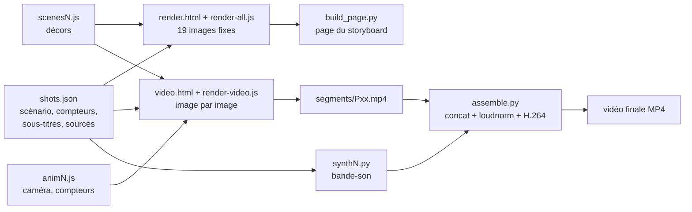

# Chaîne de production

Retour à [[00 - Carte du projet What if]]



## Les fichiers de l'outil (`outil-what-if/`)
| Fichier | Rôle |
|---|---|
| `projets/<nom>/shots.json` | Le scénario : titre, `handle` (vide = pas de pseudo), `anim` (module d'animation), `page` (textes du storyboard), et 19 plans. |
| `lib.js` | La boîte à outils 3D, voir [[05 - Boîte à outils 3D lib.js]]. |
| `scenes.js`, `scenes2.js`, `scenes3.js` | Les décors de chaque épisode (`SETS`, `SETS2`, `SETS3`) et leurs cadrages (`CAMS…`), voir [[07 - Catalogue des décors]]. |
| `anim.js`, `anim2.js`, `anim3.js` | Mouvements de caméra (`CAMANIM`), animations d'objets (`objAnim`), compteurs qui défilent (`hudValue`). |
| `render.html` + `render-all.js` | Images fixes du storyboard (une par plan). |
| `build_page.py` | La page HTML du storyboard (défauts corrigés, plans, charte, sources). |
| `video.html` + `render-video.js` | La vidéo, image par image, en segments MP4 par plan. |
| `preview.js` | Aperçu rapide : première, image du milieu et dernière image de chaque plan. |
| `synth.py`, `synth2.py`, `synth3.py` | Les bandes-son, voir [[11 - Bande-son procédurale]]. |
| `assemble.py` | Le montage final, voir [[12 - Montage et export ffmpeg]]. |

## Un plan dans `shots.json`
```json
{
 "id": "P03", "act": 1, "t0": 7.0, "dur": 4.0,
 "set": "street", "cam": "pharmacy",
 "hud": {"label": "TEMPÉRATURE À PARIS", "value": "43 °C", "tl": "JOUR 2 · 16:30"},
 "cap": "Jour 2. 43 °C. Le record de Paris,\n42,6 °C en 2019, vient de tomber.",
 "action": "Une rue haussmannienne écrasée de soleil…",
 "move": "Travelling arrière lent.",
 "sfx": "Rue au ralenti, un bus au loin, le bip de la croix de pharmacie.",
 "fix": ["D03", "D02", "D14"], "src": ["S4"]
}
```
- `set` + `cam` désignent le décor et son cadrage : `CAMS['street:pharmacy']`. Le nom de cadrage sert aussi de **variante** du décor (`street(scene, { variant: 'pharmacy' })`).
- `cap` : `\n` force un retour à la ligne.
- Le plan P19 a `"set": "endcard"` et un bloc `end` (`mono`, `cta`).

> [!tip] Générer le scénario par script
> Pour l'épisode 3, `projets/canicule/ecrire_script.py` écrit le `shots.json` (durées, `t0` cumulés, sources, textes de la page) : un seul endroit à modifier, et la durée totale est vérifiée (`assert` à 78,5 s).

## Le storyboard avant la vidéo
1. Images fixes à 720 px : `DATA=projets/x/shots.json node render-all.js 720 "" 1 projets/x/frames`.
2. Page : `python3 build_page.py <dossier> projets/x/shots.json projets/x/frames`.
3. On fait valider la page (sujet, 19 sous-titres, chute) **avant** la vidéo, qui coûte une heure de calcul.

Suite : [[04 - Rendu 3D sans carte graphique]], [[13 - Rendu en parallèle et reprises]].
